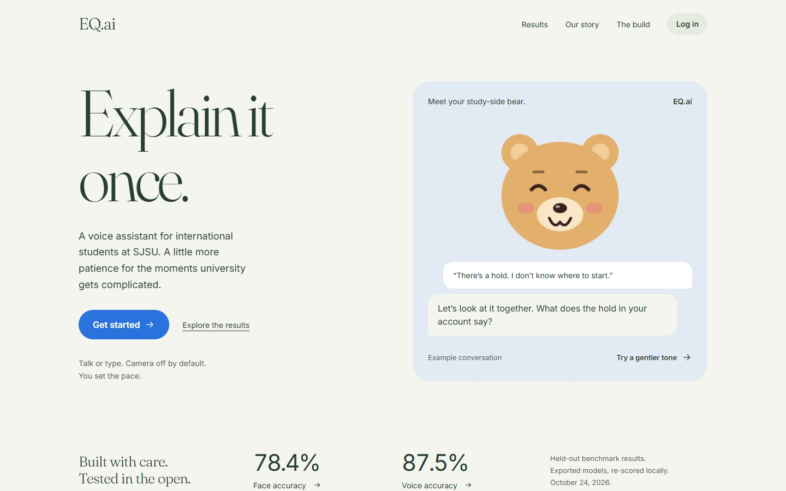
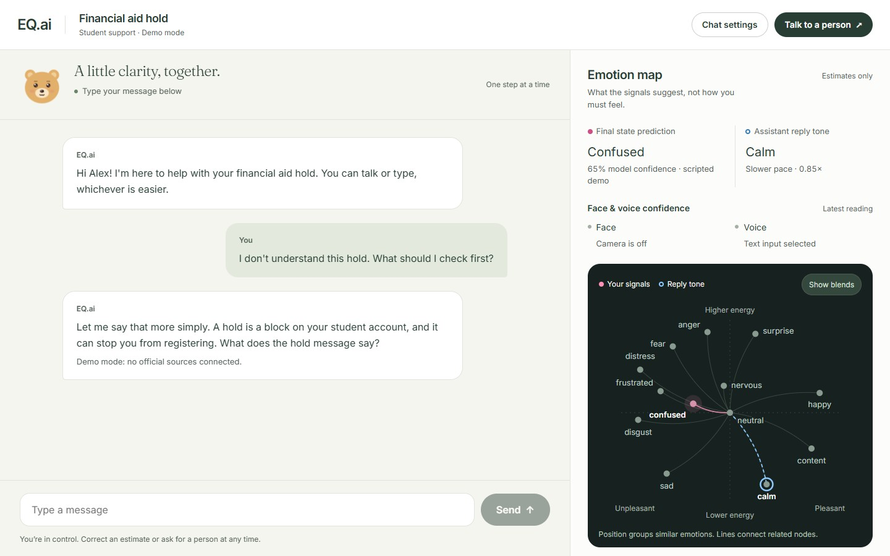
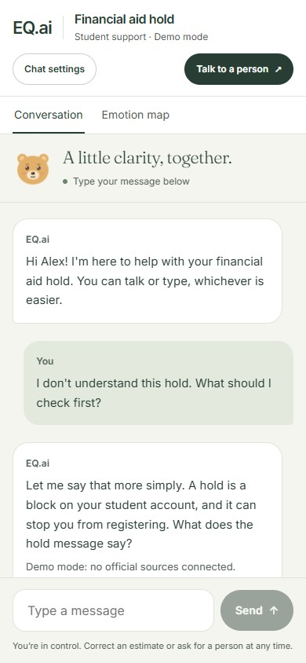
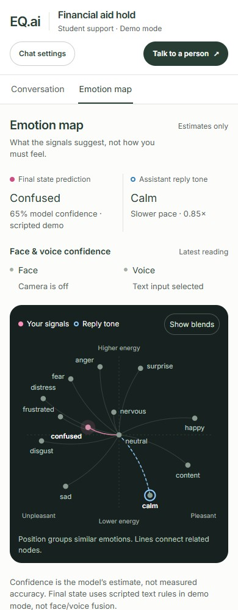

# EQ.ai student web + staff console

React + Vite + TypeScript. Styling follows `DESIGN-oura.md` (Fraunces/Inter stand in for Oura's fonts).

**Website: [eqai.study](https://eqai.study)**

## UI preview

Screenshots of the local frontend, captured October 24, 2026. The conversation uses
the app's labeled, scripted demo with a fictional student, not a real student session.
The deployed website may differ until these changes are deployed.

### Welcome page



### Conversation and emotion map

The conversation stays on the left, with a compact assistant, readable message groups,
and a persistent composer. The right panel separates the final state prediction,
face/voice confidence, and the assistant's reply tone. Chat settings group the input,
reply, and optional camera controls; the human-handoff action stays visible.



### Mobile views

Conversation and Emotion map are separate views on smaller screens, with the same
chat state preserved when switching. The map remains available on mobile.

<p>
  
  
</p>

### Understanding the predictions

- **Final state:** the latest `/chat` response's `tone.state` and `tone.confidence`.
- **Face and voice:** each perception reading's own `label` and `confidence`, shown separately.
  Disabled sensors and missing readings are stated explicitly, not shown as zero confidence.
- **Confidence is not accuracy.** The demo's final state comes from scripted text rules,
  not face/voice fusion. The screenshots intentionally show the camera off and text input;
  no sensor measurements were invented for them.
- **Map:** pink dots show estimated signals; blue rings indicate the reply tone.
  Both remain distinguishable when they occupy the same node. Show blends reveals the
  additional network connections; blended nodes are illustrative, not measured classes.
- Recent turns retain readable labels and confidence values. “How to read this map”
  explains the axes, limitations, and service status. Motion respects reduced-motion settings.

The redraw follows the installed `design-taste-frontend` and `emil-design-eng` skills:
quiet sage/bone surfaces, conversation-first hierarchy, and motion limited to useful feedback.

```bash
npm install
npm run dev        # http://localhost:5173 (student), http://localhost:5173/staff (staff console)
npm test           # policy, perception, emotion-map, training-results, voice, and case-note checks
npm run build      # type-check + production build
```

Open the student page and `/staff` in two tabs of the **same browser** to demo the live handoff.

## Pages

- `/` landing, demo login (first name only, nothing saved), topic + voice/text setup, chat with the bear.
- `/staff` handoff queue: summary, consent-gated emotion estimate, live chat, resolve.

### Landing page results

The landing page uses the aggregate snapshot in `src/trainingResults.ts`, sourced from
`training/RESULTS.md` and the saved metrics for Kaggle runs 3 and 4. Deployed ONNX scores
and Kaggle test scores are separate views; per-emotion tables use the Kaggle evaluation.
The comparison supports native horizontal touch/trackpad scrolling, mouse dragging,
navigation buttons, and Left/Right/Home/End keys when the results region has focus.
Reduced-motion preferences remove animated travel. The bear conversation is a labeled
text preview and does not activate a microphone or camera.

After a new training run, update the snapshot and its source paths. `npm test` checks that
class counts, recall-derived accuracy, and macro-F1 reconcile; it also compares against
the local training artifacts when present and verifies ONNX scores against `training/RESULTS.md`.
Missing gitignored artifacts are reported as skipped checks, not passed comparisons.

## Chat API contract (for `services/dialogue`)

Set `VITE_API_URL` (see `.env.example`). Empty = demo mode with scripted replies that never state aid rules or deadlines.

`POST {VITE_API_URL}/chat`, types in `src/policy.ts`:

```jsonc
// request
{ "session_id": "uuid", "topic": "financial_aid_hold", "text": "student turn",
  "history": [{ "role": "student" | "assistant", "text": "..." }],
  "awaiting_confirmation": false }
// response
{ "reply": { "text": "1-3 sentences", "citations": [{ "title": "...", "url": "https://..." }], "uncertainty": "optional" },
  "tone": { "state": "neutral|confused|frustrated|distress", "confidence": 0.0, "ask_confirmation": false,
            "tts_params": { "speed": 1.0, "emotion": "calm" },
            "avatar_expression": "neutral|listening|thinking|happy|concerned|sad" },
  "behavior": { "mode": "normal|slow_rephrase|confirm|offer_handoff|distress", "offer_handoff": false } }
```

The service must allow CORS from the web origin. Only `http(s)` citation links are rendered.

## Perception stream (for `services/perception`)

Set `VITE_PERCEPTION_URL` (e.g. `ws://localhost:8001`, or the Jetson IP). The chat opens `{VITE_PERCEPTION_URL}/ws/{session_id}`
with the same `session_id` as `/chat`, and sends binary messages (`src/perception.ts`):

- `0x01` + JPEG: one camera frame every 500 ms, ≤640 px wide, quality 0.7, only while the camera toggle is on.
- `0x02` + Float32 little-endian mono PCM at 16 kHz: 250 ms chunks, only while the mic is listening.

Readings (`{"type":"reading","face":…,"voice":…}`) feed the "face estimate" / "voice estimate" nodes of the emotion map,
and the face box is drawn on the camera preview. The camera and microphone are picked on the setup screen.

## Voice (Cartesia)

With `VITE_API_URL` set, `src/speech.ts` gets a 10-minute Cartesia access token from `POST {VITE_API_URL}/voice/token`
(the API key stays on the server) and talks to Cartesia directly (`src/cartesia.ts`):

- Listening: Ink 2 on `/stt/turns/websocket`. The picked mic is sent as 16 kHz `pcm_s16le`; Cartesia's turn detection
  decides when the student finished (tap), or the student holds the button and releases (push-to-talk). The same mic
  audio also goes to the perception stream while listening. The setup screen discloses that audio goes to Cartesia.
- Speaking: Sonic on `/tts/websocket` with the reply's `tts_params` (emotion, speed 0.6-1.5), played as it streams.
  If Cartesia can't speak a reply, the browser voice reads it instead.
- Demo mode (no `VITE_API_URL`): browser SpeechRecognition / speechSynthesis; Chrome sends recognition audio to Google,
  and the setup screen says so.

## Temporary stand-ins (marked `shortcut:` in code)

- Handoffs: `BroadcastChannel` (same browser only) until the SpacetimeDB `handoffs` table + subscription exists.
- Handoff summary: the student's last messages until Claude writes one.
- Landing page model results: a static, dated snapshot in `src/trainingResults.ts`; refresh it after a new measured run.
